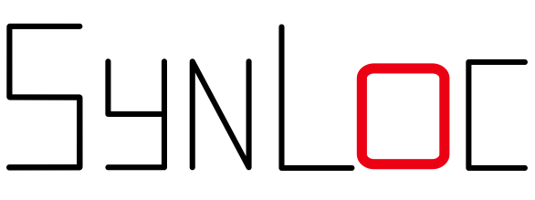
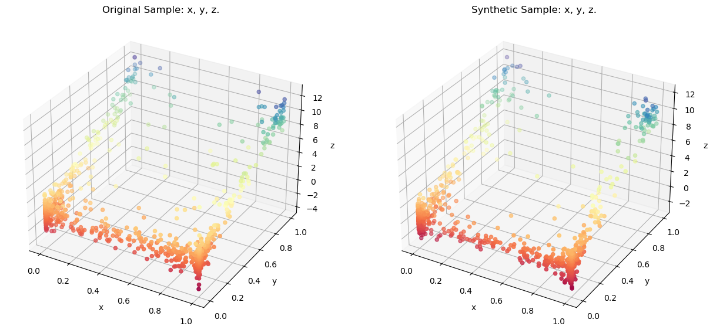

<div align="center">

# synloc: An Algorithm to Create Synthetic Tabular Data



[Overview](#overview) | [Data Requirements](#data-requirements) | [Installation](#installation) | [A Quick Example](#a-quick-example) | [Documentation](https://alfurka.github.io/synloc/) | [How to cite?](#how-to-cite) | [Replication](#replication)

[](https://pypi.org/project/synloc) [](https://pypi.org/project/synloc) [](https://pepy.tech/project/synloc)

</div>

## Overview

`synloc` is an open-source Python package implementing the **Local Resampler (LR)** algorithm for generating synthetic tabular data while safeguarding privacy. It provides a computationally efficient and flexible approach to synthetic data generation, enabling researchers to work with privacy-preserving datasets that maintain statistical utility.

### Two Subsampling Strategies

Both approaches provide effective disclosure control. Choose based on your priorities:

| Approach | Best for | Key advantage |
|----------|----------|---------------|
| **k-Nearest Neighbors (k-NN)** | Stronger disclosure control | Naturally underrepresents outliers, reducing privacy risks |
| **Clustering-based** | Efficiency & accuracy | Better data utility and computational performance |

**Key features:**
- Natural disclosure risk reduction by underrepresenting outliers (k-NN variant)
- Accurate replication of complex distributions, including multimodal and non-convex-support data
- Flexible trade-off between data utility and privacy protection
- Built-in quality diagnostics, including Kolmogorov-Smirnov distances, Wasserstein distances, summary statistics, and correlation-difference metrics
- Compatible with parametric and nonparametric distributions

This implementation aligns with statistical agencies' safe data regulations, including the **k-anonymity** criterion and the **Five Safes** framework adopted by organizations such as the Australian Bureau of Statistics. For the full methodology and theoretical foundations, see the [paper referenced below](#how-to-cite).

## Data Requirements

`synloc` expects a real numeric `pandas.DataFrame`; complex-valued data are rejected.

- Categorical variables must be encoded before synthesis, for example with `pandas.get_dummies`.
- Boolean dummy variables are accepted and converted to `0`/`1`.
- Missing numeric values are filled with column medians during fitting.
- Columns with only missing values, duplicate column names, infinite values, and non-numeric columns raise clear errors.
- For kNN resamplers, integer-like variables can be rounded after synthesis with `round_integers`. For `clusterCov`, round the returned DataFrame explicitly.

## Installation

`synloc` can be installed through [PyPI](https://pypi.org/):

```
pip install synloc
```

For the GitHub source version documented here, including model export:

```bash
python -m pip install "git+https://github.com/alfurka/synloc.git@main"
```

Version 1.1.0 retains the basic `LocalCov(...).fit()` and
`clusterCov(...).fit()` calls. For reproducible kNN fitting across worker counts,
pass an integer `random_state` to `LocalCov`; omitting it retains the legacy RNG
behaviour. Export preparation and exported-model sampling take separate seeds.
See the [release notes](docs_source/release_notes.rst) for compatibility details.

## A Quick Example

Assume that we have a sample with three variables with the following distributions:

$$x \sim Beta(0.1,\,0.1)$$

$$y \sim Beta(0.1,\, 0.5)$$

$$z \sim 10 y + Normal(0,\,1)$$

The distribution can be generated by `tools` module in `synloc`:


```python
from synloc.tools import sample_trivariate_xyz
data = sample_trivariate_xyz() # Generates a sample with size 1000 by default. 
```

Initializing the resampler:


```python
from synloc import LocalCov
resampler = LocalCov(data = data, K = 30)
```

**Subsample** size is defined as `K=30`. Now, we locally estimate the multivariate normal distribution and from each estimated distributions we draw "synthetic values."


```python
syn_data = resampler.fit() 
```

`syn_data` is a [pandas.DataFrame](https://pandas.pydata.org/docs/reference/api/pandas.DataFrame.html) where all variables are synthesized. Comparing the original sample using a 3-D Scatter:


```python
resampler.comparePlots(['x','y','z'])
```    


You can also inspect utility diagnostics after fitting:

```python
variable_metrics = resampler.compareStats()
quality = resampler.qualityReport()

print(variable_metrics[["ks_statistic", "wasserstein_distance"]])
print(quality["overall"])
```

## Distance options

`LocalCov` and `clusterCov` use Euclidean distance and `normalize=True` by
default. Each nonconstant variable is divided by its sample standard deviation
for selecting neighbours or clusters; set `normalize=False` to omit this scaling.
Nearest-neighbour calls may specify a different metric through
`Args_NearestNeighbors`. Fitted local distributions and exported mixture
means/covariances remain in original units.

## Exporting a fitted cluster model

`clusterCov` can fit reusable mixture parameters separately from synthetic
generation. Clustering may use variance scaling, but the exported Gaussian
means and covariances are in the original variable units.

```python
from synloc import clusterCov, ClusterCovSampler

model = clusterCov(data, n_clusters=20, size_min=50, clipping=False).fit_model()
report = model.clearance_report()  # internal evidence; not a privacy certificate
# For public-data research only, explicitly acknowledge unresolved review:
model.export_model("mixture.npz", reviewed=True)
sampler = ClusterCovSampler.load("mixture.npz")
synthetic = sampler.sample(1000, random_state=123)
```

The export contains versioned numeric mixture parameters and column names, not
source rows, cluster memberships, original extrema, or a pickled estimator.
The external sampler does not clip to confidential extrema. `reviewed=True`
acknowledges unresolved disclosure risks; it does not establish regulatory
approval or differential privacy. Contributor checks assume one person per row.
The existing `fit()` workflow remains available.
Fitted parameters are read-only: this keeps sampling, export and internal review
evidence consistent. Refit rather than editing arrays in place.

## Exporting a fitted kNN model

`LocalCov.prepare_export()` selects anchors before fitting their local
distributions. It uses the full input to find neighbours and returns a fixed
proposal so that the internal report describes exactly what will be exported.

```python
from synloc import LocalCov, ClusterCovSampler

model = LocalCov(data, K=100, normalize=True)
proposal = model.prepare_export(n_components=50, random_state=42, minimum_contributors=100)
report = proposal.clearance_report()  # internal evidence, not release approval
proposal.export_model("local-mixture.npz", reviewed=True)
sampler = ClusterCovSampler.load("local-mixture.npz")
synthetic = sampler.sample(1000, random_state=123)
```

`n_components=None` (the default) uses all rows as anchors; a smaller count
selects distinct anchors uniformly without replacement. `K` specifies the
neighbourhood size, independently of the number exported. An optional
`minimum_contributors` blocks export when the actual neighbourhood row count is
too small. `reviewed=True` acknowledges unresolved review; neither it nor a
smaller export guarantees privacy. Overlapping neighbourhoods and repeated
exports can reveal information jointly. Reports are confidential, and exported
sampling does not use source bounds. `LocalCov.fit()` remains available.

## How to cite?

If you use `synloc` in your research, please cite the following paper:

```bibtex
@article{https://doi.org/10.1111/anzs.70032,
    author = {Kalay, Ali Furkan},
    title = {Generating Synthetic Data With Locally Estimated Distributions for Disclosure Control},
    journal = {Australian \& New Zealand Journal of Statistics},
    volume = {68},
    number = {1},
    pages = {e70032},
    doi = {https://doi.org/10.1111/anzs.70032},
    url = {https://onlinelibrary.wiley.com/doi/abs/10.1111/anzs.70032},
    eprint = {https://onlinelibrary.wiley.com/doi/pdf/10.1111/anzs.70032},
    year = {2026}
}


```

## Replication

For replication materials of the paper, see the [replication folder](replication/).
