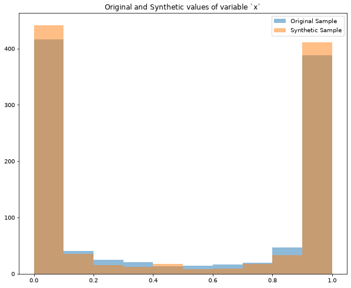
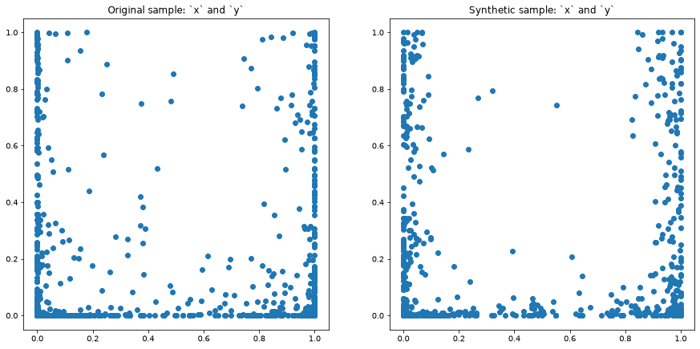
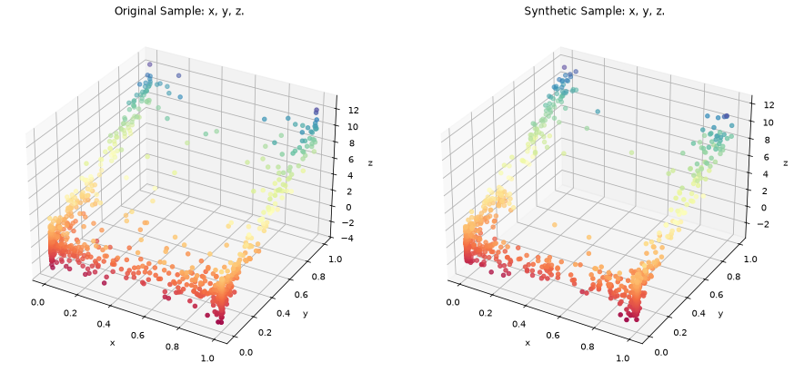

Usage
=====

Nearest-neighbor resampling
---------------------------

``LocalCov`` estimates a local covariance matrix from each observation's
nearest-neighbor neighborhood and draws one synthetic value from the estimated
multivariate normal distribution.

.. code-block:: python

   import synloc as s

   data = s.sample_trivariate_xyz(1000)
   resampler = s.LocalCov(data=data, K=30, n_jobs=1)
   synthetic = resampler.fit()

``synthetic`` is a ``pandas.DataFrame`` with the same columns as ``data``.
If a variable is constant inside a local neighborhood, that variable is copied
exactly for the synthetic value drawn from that neighborhood.

Use ``sample_size`` to request a different synthetic sample size:

.. code-block:: python

   synthetic = resampler.fit(sample_size=500)

Cluster resampling
------------------

``clusterCov`` clusters the data with KMeans, estimates a covariance matrix
inside each cluster, and draws synthetic observations cluster by cluster.
If a variable is constant inside a cluster, that variable is copied exactly for
synthetic rows generated from that cluster.

.. code-block:: python

   import synloc as s

   data = s.sample_circulars_xy(1000)
   resampler = s.clusterCov(data=data, n_clusters=20, size_min=8)
   synthetic = resampler.fit()

Visualization
-------------

After fitting, compare one, two, or three variables visually. The figures below
use the ``LocalCov`` example:

.. code-block:: python

   data = s.sample_trivariate_xyz(1000)
   resampler = s.LocalCov(data=data, K=30, n_jobs=1)
   synthetic = resampler.fit()

One variable gives overlaid histograms:

.. code-block:: python

   resampler.comparePlots(["x"])

Two variables give side-by-side scatter plots:

.. code-block:: python

   resampler.comparePlots(["x", "y"])

Three variables give side-by-side 3-D scatter plots:

.. code-block:: python

   resampler.comparePlots(["x", "y", "z"])

The plotting helper is intended for quick diagnostics. For publication figures,
use the returned synthetic data with your preferred plotting workflow.
