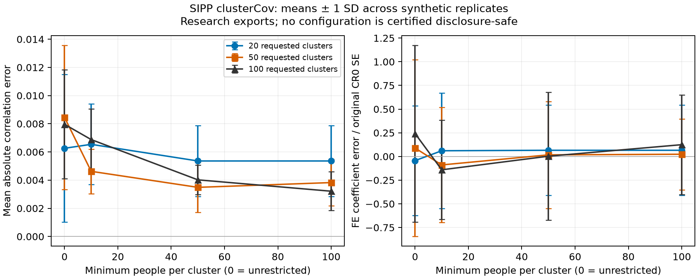

# SIPP clusterCov experiment — 29 October 2026

## Decision

**The model-export workflow works; the unconstrained Gaussian mixture is not yet a satisfactory generator of valid earnings/hours panels containing nonworkers.** Linear-moment and regression preservation is strong, but synthetic hours are negative in roughly 12–12.5% of person-quarters and almost all exact zeros disappear. Do not describe these research exports as disclosure-cleared or as fully realistic panels.

Only `clusterCov` was evaluated: no overlapping kNN estimator, second synthesis method, or second empirical dataset. No outcome transformation, post-hoc clipping, employment restriction, or tail trimming was used to conceal these findings.

## Verified data and selection

The supplied `pu2018.csv.gz` matches the official 4,942-field Census schema. Full processing confirms panel 2018, wave 1; Census documentation identifies the reference period as January–December **2017**. The local file is identified by SHA-256, not authenticated against a published Census checksum:

```text
d81a8b5debfe33ad371798cc7607cc43054bfa4efbd79e32bddd48ca3c801943
```

| Sequential inclusion stage | People remaining | People excluded at this step |
|---|---:|---:|
| Input | 63,915 | — |
| Twelve unique months | 63,283 | 632 |
| In survey frame throughout | 62,768 | 515 |
| Age 18–64 throughout | 37,573 | 25,195 |
| Complete valid labour outcomes after structural-zero handling | **37,552** | 21 |

The final sample has **450,624 person-months**, **150,208 person-quarters**, and eight wide-format variables. Earnings are quarterly sums of `TPEARN`; hours are quarterly averages of monthly `TMWKHRS` weekly-hours rates. Missing earnings/hours were set to zero for **127,922 retained person-months** only where `RMNUMJOBS=0`. Observed negative business earnings were preserved: 354 retained people have 3,437 such monthly observations.

This is an unweighted, balanced analytical sample, not a representative national estimate. Public-use earnings may already be imputed or topcoded. [Preparation details](DATA_PREPARATION.md) and [machine-readable provenance](summary/preparation.json) record all assumptions.

## Experiment and verification

- Requested cluster counts: 20, 50, 100.
- Minimum contributor counts: unrestricted, 10, 50, 100.
- **12 configurations × 10 synthetic replicates = 120 panels**, each with 37,552 people and four quarters.
- Clustering uses variance scaling; Gaussian moments are fitted/exported in original units. No inverse normalization parameters are needed externally.
- All 12 exports passed exact seeded direct-versus-imported comparison, including a **fresh Python interpreter** receiving only the model artifact and sampling arguments.
- Gaussian sampling was also smoke-checked against theoretical mixture moments, including exact preservation of a constant dimension.
- **64 behavioral tests passed**; dependency consistency check passed. Coverage includes malformed archives, parameter-only export, constants, singular covariance, missing-data handling, panel preparation, and independent dummy-variable checks of the fixed-effects/CR0 implementation.
- Exports range from **7,048 to 34,128 bytes**, excluding internal audit evidence.

The archive contains only version, variable names, mixture weights, means and covariances. Original rows, IDs, cluster assignments, confidential extrema and audit reports are absent. The sampler does not require the original standard deviations because scaling only determines cluster membership, not the units of exported moments.

## Representative results: 50 requested clusters, minimum size 50

This is an illustrative middle configuration, **not a selected winner or cleared release**. It yields 36 realised components, ranging from 66 to 9,665 people, and a 15,278-byte export.

| Metric | Original panel | Synthetic mean | SD across 10 synthetic panels |
|---|---:|---:|---:|
| Quarterly earnings mean ($) | 10,358.10 | 10,385.21 | 82.12 |
| Weekly-hours mean | 28.310 | 28.352 | 0.078 |
| Earnings adjacent-quarter correlation | 0.91415 | 0.91450 | 0.00248 |
| Hours adjacent-quarter correlation | 0.95352 | 0.95332 | 0.00048 |
| Pooled earnings–hours coefficient | 380.298 | 381.191 | 3.572 |
| Individual-FE earnings–hours coefficient | 286.638 | 286.846 | 6.940 |
| Zero earnings (%) | 28.45 | 0.00 | 0.00 |
| Zero hours (%) | 27.64 | 0.00 | 0.00 |
| Negative earnings (%) | 0.77 | 16.58 | 0.12 |
| Negative hours (%) | 0.00 | 12.39 | 0.13 |

Regressions include quarter effects. Person-clustered CR0 standard errors have no finite-sample adjustment. The original FE coefficient's CR0 standard error is 12.302; the synthetic mean difference for this configuration is only 0.017 original standard errors. Synthetic replicate SDs are conditional on a fixed fitted model, not confidence intervals accounting for model estimation, survey design, or synthesis uncertainty.

**Interpretation:** good linear-regression preservation is largely expected when first and second moments are retained. It is not independent evidence that zero masses, support, nonlinear dependence, or disclosure protection are adequate. Negative earnings can be legitimate business losses, but their large frequency increase is still a substantial distortion. Negative hours are invalid.

## Configuration and disclosure findings

| Requested clusters | Minimum size | Realised clusters | Smallest cluster | Rank-deficient components | Failed assessed dominance statistics |
|---:|---:|---:|---:|---:|---:|
| 20 | unrestricted | 20 | 6 | 3 | 0 |
| 20 | 10 | 18 | 22 | 1 | 0 |
| 20 | 50 | 15 | 180 | 0 | 0 |
| 20 | 100 | 15 | 180 | 0 | 0 |
| 50 | unrestricted | 50 | 1 | 10 | 20 |
| 50 | 10 | 44 | 17 | 3 | 0 |
| 50 | 50 | 36 | 66 | 0 | 0 |
| 50 | 100 | 31 | 144 | 0 | 0 |
| 100 | unrestricted | 100 | 1 | 27 | 103 |
| 100 | 10 | 80 | 13 | 6 | 3 |
| 100 | 50 | 62 | 59 | 0 | 0 |
| 100 | 100 | 50 | 149 | 0 | 0 |

A dominance statistic is one component-variable check; it fails if either the largest-contributor 50% or top-two 67% diagnostic fails. These are nonnegative-magnitude diagnostics, not clearance tests for covariance entries. Negative-valued components are not applicable; zero totals would be unassessed. For the representative configuration, 218 component-variable checks are assessed and 70 are not assessed/applicable. No assessed dominance failures does **not** mean every released statistic passes a disclosure rule.

Minimum sizes remove singleton/small components and reduce the realised number of clusters. At 20 requested clusters, minima 50 and 100 produce the same fitted model; their identical results are not independent evidence of a plateau. Weights may expose underlying counts when the sample size is known. Household dependence, covariance cross-products, joint parameter reconstruction and inferential attacks remain unassessed. Rank is an empirical degeneracy diagnostic, not a privacy test.

All exports explicitly acknowledge unresolved review (`reviewed=True`) for this public-data experiment; **privacy approval is false for every configuration**. Only required contributor checks mechanically gate this research export. Failed dominance checks remain visible rather than being silently called approval.

## Figure and reproducible evidence



The figure shows means ± one synthetic-replicate SD, not confidence intervals. Shared seeds pair configurations; the ten draws are independent within each configuration. [PDF](summary/utility_tradeoff.pdf), [full utility table](summary/utility_summary.csv), [all replicate metrics](summary/replicate_metrics.csv), [model diagnostics](summary/models.csv), [original metrics](summary/original_metrics.json), and [run manifest](summary/manifest.json) preserve the numerical evidence. The figure was visually inspected for labels and clipping; it is a research figure, not a journal-compliance claim.

The `summary/` directory is a dated aggregate evidence snapshot. Scripts recreate the evidence under ignored `prepared/` and `results/` directories using the commands in [README](README.md). Person-level prepared/synthetic data, full internal audits, and model archives remain local and untracked. No raw or synthetic microdata are committed.

## Research implication

The compact reusable export is demonstrated, but this experiment alone does not justify a claim of realistic full-population labour panels or disclosure-safe release. A later modelling decision must address the employment/zero mass and support explicitly. Simply flooring negative hours at zero changes the fitted distribution and would not by itself restore the observed zero mass; it should not be presented as a validated fix. Restricting the sample to continuously employed people would change the research population and must not replace or hide this baseline result.
